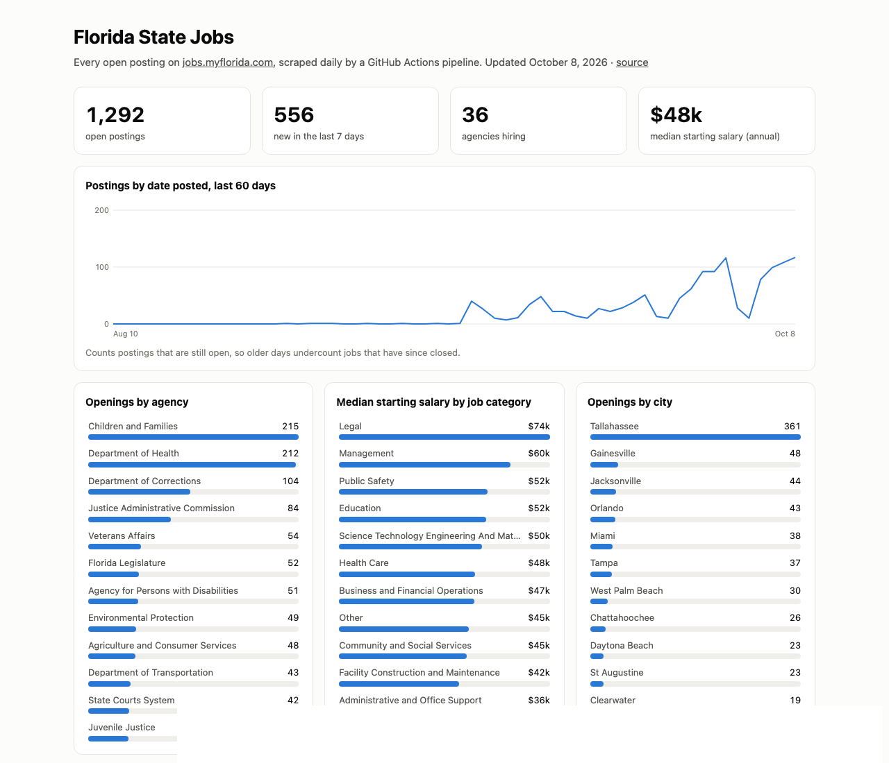

# Florida State Jobs Pipeline

A daily data pipeline that tracks every open State of Florida job posting on
[jobs.myflorida.com](https://jobs.myflorida.com), cleans the salary data, and
publishes a live dashboard.

**Live dashboard:** https://gopivardhan1965.github.io/florida-jobs-pipeline/



## What it does

```
jobs.myflorida.com ──► scrape.py ──► data/jobs.csv ──► docs/data.json ──► GitHub Pages dashboard
   (~52 listing pages)   incremental     history table      compact feed       docs/index.html
                         detail fetch    (first/last seen)
        ▲
   GitHub Actions cron, daily 7am ET
```

- **Extract:** crawls all listing pages (title, agency, category, city, posted date)
  every run, and fetches detail pages (requisition no., pay plan, salary, closing
  date) **only for postings it hasn't seen before**. A full backfill takes about 15 minutes;
  a daily run takes about a minute.
- **Transform:** salaries are free text in a dozen formats (`$24.00-$35.00`,
  `$1,953.15 - $2,249.52 Biweekly`, `$50,000.08 annually / $1,923.08 bi-weekly`,
  `$46,583.04 plus $1,268.76 CAD`). `parse_salary` annualises them by magnitude
  and prefers an explicit annual figure, and `test_scrape.py` pins the real-world cases.
- **Load:** `data/jobs.csv` is a slowly-changing table. Each posting keeps
  `first_seen` / `last_seen`, so the repo's history shows when jobs opened and
  closed and how long they stayed up. The CSV is diff-friendly, so every daily
  commit is an auditable change log.
- **Guardrail:** if a run finds fewer than 100 listings (site outage or markup
  change), it exits non-zero instead of marking every job as closed. The failed
  Actions run is the alert.
- **Serve:** `docs/index.html` is a dependency-free static dashboard with KPIs,
  the open-postings trend, openings by agency and city, median salary by category,
  and a searchable table with a "data & tech roles" filter.

## Run it locally

Standard library only, Python 3.9+:

```bash
python test_scrape.py   # salary parser checks
python scrape.py        # updates data/jobs.csv and docs/data.json
python -m http.server -d docs   # open http://localhost:8000
```

## Background

This started as a set of Selenium notebooks I used to find data roles in
Florida state government (`notebooks/`). Selenium turned out to be unnecessary
because the search pages are server-rendered. The rewrite uses plain HTTP and is
incremental, so it can run unattended on a schedule.
